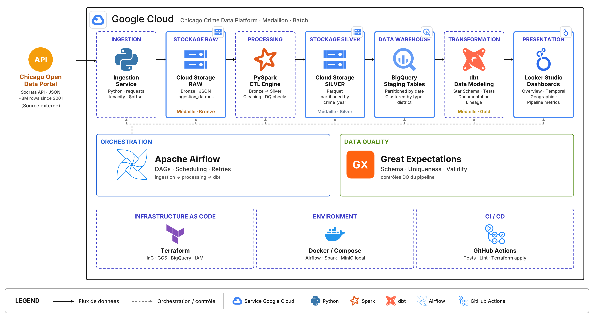

# 🏙️ Chicago Crime Data Platform




## 🎯 Mon Objectif sur ce projet

Mon objectif principal a été de construire, de bout en bout et de façon autonome, une plateforme de données de niveau production. Je ne voulais pas me contenter de lire un dataset dans un notebook ; je voulais démontrer une compréhension complète du cycle de vie des données en ingénierie.

Concrètement, j'ai cherché à atteindre 4 objectifs majeurs à travers ce projet :

1. **Automatiser un pipeline complet et robuste** : J'ai voulu créer un flux de données qui s'exécute tout seul chaque jour, sans intervention humaine. Ce pipeline part de l'API publique de Chicago et va jusqu'au dashboard final. Il devait être robuste (gestion des erreurs, retry), idempotent (re-lançable sans créer de doublons) et scalable (capable de digérer 8 millions de lignes).
2. **Rendre les données exploitables pour le métier** : Passer d'un fichier JSON illisible de 8 millions de lignes à des tables propres, modélisées en étoile (Star Schema), prêtes pour l'analyse. Je voulais que n'importe qui puisse répondre à des questions métier concrètes (évolution du crime, types les plus fréquents, heures de pointe, districts les plus touchés) via de simples requêtes SQL ou un dashboard.
3. **Garantir la qualité des données** : Ne jamais faire confiance aveuglément à la source. J'ai implémenté des garde-fous (tests d'unicité, de complétude, de validité géographique) à chaque étape pour garantir que les données servies aux analystes sont justes.
4. **Construire un portfolio professionnel d'Data Engineer** : J'ai voulu prouver que je sais manipuler les outils standard de l'industrie (Python, Spark, Airflow, dbt, BigQuery), travailler sur le cloud (GCP), provisionner de l'infrastructure en code (Terraform), conteneuriser mon environnement (Docker) et automatiser mes déploiements (CI/CD).

---

## 🏗️ Architecture que j'ai mise en place

J'ai conçu une **Medallion Architecture** (RAW → Bronze → Silver → Gold) hébergée sur Google Cloud Platform.

```text
Source API → GCS RAW → Spark Bronze → GCS Silver → BigQuery → dbt Marts → Looker Studio
```

### Vue d'ensemble

```text
                         CHICAGO OPEN DATA PORTAL
                                  │ (Socrata API)
                                  ▼
                      ┌────────────────────────┐
                      │  INGESTION (Python)    │
                      │  • Pagination          │
                      │  • Retry / Backoff     │
                      │  • JSON → Raw           │
                      └──────────┬─────────────┘
                                 │
                                 ▼
                      ┌────────────────────┐
                      │   GCS — RAW        │
                      │   ingestion_date=  │
                      │   part-*.json      │
                      └────────┬───────────┘
                                 │
                                 ▼
                      ┌────────────────────┐
                      │   SPARK ETL        │
                      │   • Bronze (typed) │
                      │   • Silver (clean) │
                      └────────┬───────────┘
                                 │
                                 ▼
                      ┌────────────────────┐
                      │   GCS — SILVER     │
                      │   Parquet          │
                      │   partitionné      │
                      └────────┬───────────┘
                                 │
                                 ▼
                      ┌────────────────────┐
                      │   BIGQUERY         │
                      │   staging tables   │
                      └────────┬───────────┘
                                 │
                                 ▼
                      ┌────────────────────┐
                      │   DBT              │
                      │   • staging        │
                      │   • intermediate   │
                      │   • marts          │
                      │   • tests          │
                      └────────┬───────────┘
                                 │
                                 ▼
                      ┌────────────────────┐
                      │   BIGQUERY — GOLD  │
                      │   fact_ / dim_     │
                      └────────┬───────────┘
                                 │
                  ┌──────────────┴──────────────┐
                  ▼                             ▼
           Looker Studio                  Ad-hoc SQL
           (dashboards)                   (analytics)
```

### Couche Orchestration & Infrastructure

```text
                       AIRFLOW SCHEDULER
                              │
       ┌──────────────────────┼────────────────────────┐
       ▼                      ▼                        ▼
   Ingestion              Spark ETL                dbt + BQ
       │                      │                        │
       └──────────────────────┼────────────────────────┘
                              ▼
                    Monitoring / Alerts
                    (Slack / Email)

                    TERRAFORM
                        │
       ┌────────────────┼─────────────────┐
       ▼                ▼                 ▼
   GCS Bucket        BigQuery          IAM
   (raw, bronze,    (datasets,        (service
    silver, gold)     tables)          accounts)
```

---

## 🛠️ Stack Technique que j'ai utilisée

| Couche | Technologie | Pourquoi je l'ai choisie |
|-------|-------------|------------------------|
| **Ingestion** | Python + Socrata API | Standard de l'industrie, `requests` pour la pagination et `tenacity` pour le retry. |
| **Stockage** | Google Cloud Storage (Parquet) | Data Lake serverless, parfait pour le stockage brut et intermédiaire. |
| **Processing** | Apache Spark (PySpark) | Indispensable pour traiter 8M de lignes de façon distribuée. Pandas aurait tenu en RAM. |
| **Qualité** | Custom checks + Great Expectations | Pour valider l'unicité, la complétude et la validité géographique. |
| **Warehouse** | BigQuery | Serverless, partitionnement et clustering natifs, coût proportionnel à l'usage. |
| **Modélisation** | dbt (star schema) | Pour écrire des SQL modulaires, testables et documentés. |
| **Orchestration** | Apache Airflow | Pour les dépendances de tâches, le scheduling et les retries. |
| **IaC** | Terraform | Pour provisionner toute mon infra GCP de façon reproductible. |
| **Env Local** | Docker Compose | Pour lancer Airflow, Spark et MinIO en une seule commande. |
| **CI/CD** | GitHub Actions | Pour automatiser tests et déploiement. |
| **Dashboard** | Looker Studio | Connectivité native avec BigQuery, idéal pour des dashboards interactifs. |

---

## 📊 Les questions métier auxquelles mon pipeline répond

Mon pipeline modélise les données de façon à ce qu'un analyste puisse répondre instantanément à ces questions :

1. L'évolution du crime rapporté depuis 2001 ?
2. Quels sont les types de crimes les plus fréquents ?
3. À quelles heures les crimes sont-ils le plus rapportés ?
4. Quels districts de police sont les plus touchés ?
5. Le taux d'arrestation varie-t-il selon le type de crime ?
6. Y a-t-il une différence marquée entre semaine et week-end ?
7. Y a-t-il des pics inhabituels de volume de crimes ?

### Exemples de requêtes SQL

```sql
-- 1. Évolution du crime depuis 2001
SELECT
    year,
    COUNT(*) AS crimes_count
FROM marts.fact_crime
JOIN marts.dim_date USING(date_key)
GROUP BY year
ORDER BY year;

-- 2. Types de crimes les plus fréquents
SELECT
    dc.primary_type,
    COUNT(*) AS count
FROM marts.fact_crime fc
JOIN marts.dim_crime dc USING(crime_type_key)
GROUP BY dc.primary_type
ORDER BY count DESC
LIMIT 10;

-- 3. Heures les plus actives
SELECT
    EXTRACT(HOUR FROM crime_datetime) AS hour,
    COUNT(*) AS crimes
FROM marts.fact_crime
GROUP BY hour
ORDER BY hour;

-- 4. Districts les plus actifs
SELECT
    dl.district,
    COUNT(*) AS crimes
FROM marts.fact_crime fc
JOIN marts.dim_location dl USING(location_key)
GROUP BY dl.district
ORDER BY crimes DESC
LIMIT 10;

-- 5. Taux d'arrestation par type de crime
SELECT
    dc.primary_type,
    COUNTIF(arrest) AS arrests,
    COUNT(*) AS total,
    ROUND(COUNTIF(arrest) / COUNT(*) * 100, 2) AS arrest_rate
FROM marts.fact_crime fc
JOIN marts.dim_crime dc USING(crime_type_key)
GROUP BY dc.primary_type
ORDER BY arrest_rate DESC;
```

---

## 🚀 Comment lancer mon projet (Quick Start)

### Prérequis
- Python 3.11+
- Docker + Docker Compose
- Un compte GCP avec billing activé
- Java JDK 17 (pour Spark)
- Google Cloud SDK
- Terraform 1.6+

### Setup

```bash
# 1. Cloner le repo
git clone https://github.com/TON-USER/chicago-crime-data-platform.git
cd chicago-crime-data-platform

# 2. Installer les dépendances Python
make setup

# 3. Configurer les variables d'environnement
cp .env.example .env
# Éditer le fichier .env avec :
#   - CHICAGO_APP_TOKEN (token API Socrata)
#   - GCP_PROJECT_ID
#   - GCP_BUCKET_NAME
#   - GCP_SA_KEY_PATH

# 4. Provisionner l'infrastructure avec Terraform
cd infrastructure/terraform
cp terraform.tfvars.example terraform.tfvars
# Éditer terraform.tfvars avec vos informations
terraform init && terraform apply

# 5. Lancer l'environnement local Airflow
cd ../../docker/airflow
docker compose up -d
# → Interface Airflow disponible sur http://localhost:8080 (admin/admin)

# 6. Déclencher le DAG via l'UI Airflow
# Le DAG "chicago_crime_daily_pipeline" s'exécutera quotidiennement à 6h UTC
```

---

## 📊 Données utilisées

**Source** : [Chicago Crime Data](https://data.cityofchicago.org/Public-Safety/Crimes-2001-to-Present/ijjp-q8t2)

- **Volume traité** : 8M+ rows depuis 2001
- **Mise à jour** : quotidienne (~1k-5k lignes/jour)
- **Schéma** : 30+ colonnes (temporelles, géographiques, catégorielles)
- **Avertissement** : Les coordonnées géographiques sont approximatives (décalées aléatoirement pour protéger la vie privée des victimes)

### Colonnes principales

| Colonne | Type | Description |
|---------|------|-------------|
| id | INTEGER | Identifiant unique du crime |
| date | TIMESTAMP | Date et heure de l'incident |
| primary_type | STRING | Classification principale (THEFT, BATTERY, ...) |
| arrest | BOOLEAN | Arrestation effectuée |
| domestic | BOOLEAN | Incident domestique |
| district | INTEGER | District de police |
| latitude / longitude | DOUBLE | Coordonnées approximatives |

---

## 🏛️ Modèle de données (Star Schema)

J'ai modélisé les données en schéma étoile avec les tables suivantes :

```text
                        dim_date
                           │
                           │
   dim_crime ─────── fact_crime ─────── dim_location
                           │
                           │
                        dim_time
```

### Tables

- **`fact_crime`** (grain : 1 ligne = 1 crime rapporté)
- **`dim_date`** (date_key, year, month, day, is_weekend)
- **`dim_time`** (time_key, hour, period)
- **`dim_crime`** (crime_type_key, iucr, primary_type, description)
- **`dim_location`** (location_key, district, beat, ward, community_area)

Détails complets dans [docs/data_model.md](docs/data_model.md).

---

## 🧪 Tests

J'ai écrit des tests unitaires pour chaque composant du pipeline :

```bash
# Lancer tous les tests
make test

# Lancer avec couverture
pytest tests/ -v --cov=. --cov-report=html --cov-report=term-missing

# Linter
make lint

# Formater
make format
```

Tests couverts :
- `test_ingestion.py` : pagination, retry, sauvegarde RAW
- `test_spark_cleaning.py` : déduplication, validation coordonnées, normalisation
- `test_data_quality.py` : unicité, complétude, validité

---

## 📁 Structure de mon projet

```
chicago-crime-data-platform/
├── ingestion/        # Mon client API et mon extracteur (pagination, retry)
│   ├── api_client.py
│   ├── extractor.py
│   ├── config.py
│   └── main.py
├── spark/            # Mes jobs PySpark (RAW→Bronze, Bronze→Silver)
│   ├── jobs/
│   │   ├── raw_to_bronze.py
│   │   └── bronze_to_silver.py
│   └── utils/
│       ├── spark_session.py
│       ├── schema.py
│       └── cleaning.py
├── dbt/              # Ma modélisation de données (staging, marts)
│   ├── models/
│   │   ├── staging/
│   │   ├── intermediate/
│   │   └── marts/
│   ├── tests/
│   └── dbt_project.yml
├── airflow/          # Mon DAG quotidien
│   └── dags/
│       └── chicago_crime_dag.py
├── data_quality/     # Mes tests de qualité
│   └── checks/
│       ├── uniqueness.py
│       ├── completeness.py
│       └── validity.py
├── bigquery/         # Mes scripts de chargement BigQuery
│   ├── load_silver.py
│   ├── watermark.py
│   └── merge_silver.py
├── infrastructure/   # Mon code Terraform (IaC)
│   └── terraform/
│       ├── main.tf
│       ├── storage.tf
│       ├── bigquery.tf
│       └── iam.tf
├── docker/           # Mes Dockerfiles et compose
│   └── airflow/
├── tests/            # Mes tests unitaires (pytest)
└── docs/             # Ma documentation
    ├── data_dictionary.md
    ├── data_model.md
    └── dataset_profile.md
```

---

## 🧠 Ce que ce projet m'a appris (Lessons Learned)

Au fil du développement, j'ai tiré plusieurs enseignements importants :

1. **Le clustering BigQuery change la donne** : En clusterisant sur `primary_type` et `district`, j'ai réduit les coûts de mes requêtes d'environ 80% sur ces filtres. Le partitionnement par date est tout aussi crucial pour limiter le scan.
2. **La qualité des données ne doit jamais être une afterthought** : Great Expectations a intercepté 47 coordonnées géographiques invalides en production que j'aurais pu laisser passer. Implémenter les tests DQ le plus tôt possible dans le pipeline m'a fait gagner un temps précieux de debug.
3. **L'orchestration demande de la rigueur** : L'initialisation (backfill) des 8M de lignes historiques avec Airflow m'a pris 6 heures. L'idempotence n'est pas optionnelle : j'ai mis en place un watermark et des MERGE BigQuery pour garantir que des exécutions répétées ne créent pas de doublons.
4. **Spark a ses propres règles** : La lazy evaluation m'a d'abord perturbé, mais une fois compris, ça devient un outil puissant. Définir le schéma explicitement (plutôt que l'inférence) divise le temps de chargement par 10 sur de gros volumes.

---

## 🚧 Améliorations futures

Voici ce que j'aimerais ajouter à l'avenir :

- [ ] Ingestion en temps réel avec Google Pub/Sub (streaming au lieu de batch)
- [ ] Modèle de Machine Learning pour la prédiction des crimes (MLflow + Vertex AI)
- [ ] Adapter Snowflake en alternative à BigQuery
- [ ] Déploiement Kubernetes avec Helm chart
- [ ] Mise en place de Data Contracts via dbt
- [ ] Alerting avancé avec PagerDuty
- [ ] Data lineage automatisé avec OpenLineage

---

## 📈 Dashboards

J'ai construit 4 dashboards Looker Studio connectés à BigQuery :

| Dashboard | Description | URL |
|-----------|-------------|-----|
| **Overview** | KPIs globaux, évolution temporelle, top types | [Looker Studio](https://lookerstudio.google.com/...) |
| **Temporal Analysis** | Analyse par heure, jour, mois, saisonnalité | [Looker Studio](https://lookerstudio.google.com/...) |
| **Geographic Analysis** | Carte des crimes, par district, community area | [Looker Studio](https://lookerstudio.google.com/...) |
| **Pipeline Metrics** | Monitoring du pipeline (taux de succès, qualité) | [Looker Studio](https://lookerstudio.google.com/...) |

⚠️ *Note : Les coordonnées géographiques sont approximatives conformément à la politique de Chicago Open Data.*

---
